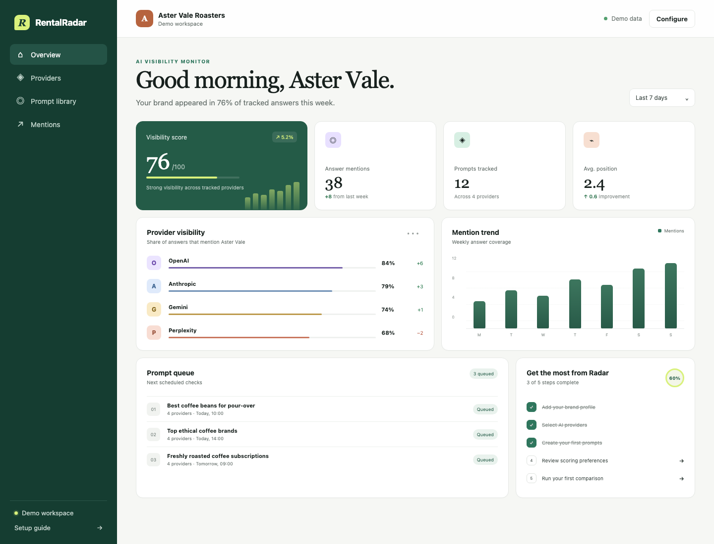
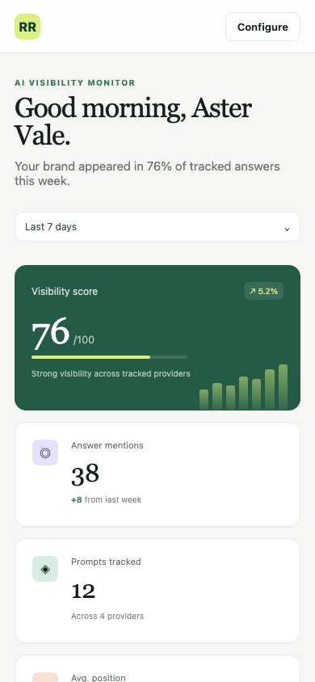
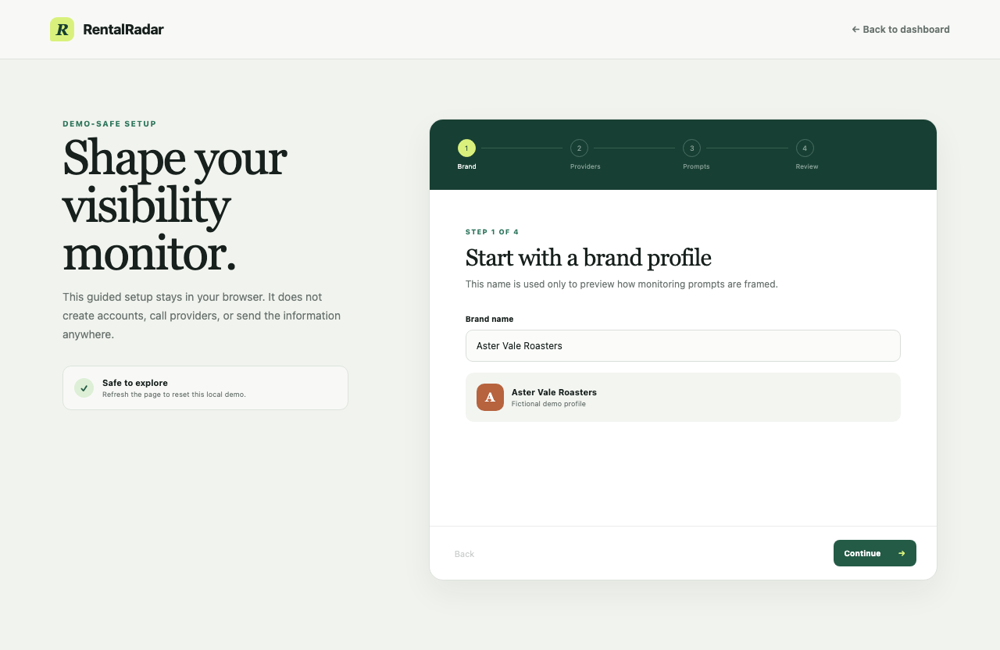

# RentalRadar public edition

RentalRadar is a small, demo-safe reference application for monitoring how a brand appears in AI-generated answers. It turns mentions, answer position, sentiment, and citations into an explainable visibility score and a provider comparison dashboard.

The included brand, Aster Vale Roasters, is unmistakably fictional. Demo mode is deterministic, needs no credentials, sends no telemetry, and is the default for development, tests, and builds.

## Screenshots

| Desktop dashboard | 390px mobile dashboard |
| --- | --- |
|  |  |



## Features

- Responsive visibility dashboard with provider comparisons, prompt queue, mention trend, and onboarding progress
- Useful four-step onboarding preview that keeps all input in browser memory
- Deterministic adapters and fixtures for OpenAI, Anthropic, Gemini, and Perplexity
- Explainable 100-point scoring model covering mentions, position, sentiment, and citations
- Tenant-scoped in-memory repository that fails closed for missing or cross-tenant access
- Server-only environment parsing and optional generic HTTP adapters
- Focused Vitest coverage for configuration, tenant boundaries, demo behavior, provider behavior, and scoring

## Setup

Requirements: Node.js 20.9 or newer and npm.

```sh
npm install
npm run dev
```

Open the local address printed by Next.js. The dashboard works immediately with no `.env` file.

To review all project checks:

```sh
npm test
npm run typecheck
npm run lint
npm run build
```

For optional server-side HTTP adapters, copy `.env.example` to `.env.local`, set `DEMO_MODE=false`, select providers, and replace the placeholders. The generic adapter expects a JSON endpoint that accepts `{ model, brand, prompt }` and returns fields compatible with `mentioned`, `rank`, `sentiment`, `cited`, and `summary`.

## Security model

- Demo mode is the safe default and ignores adapter credentials.
- Secret-bearing configuration and HTTP adapters are marked server-only.
- The browser receives only the public runtime mode and provider names.
- Repository access requires an explicit tenant scope; cross-scope access returns the same unavailable error as a missing record.
- There is no authentication, payment processing, customer data, analytics, persistence, or production deployment wiring.

This project is a reference implementation, not a security boundary for untrusted multi-user deployment. Read [docs/SECURITY.md](docs/SECURITY.md) before adapting it beyond local evaluation.

## Scoring model

The score is intentionally simple and inspectable:

| Component | Weight | Interpretation |
| --- | ---: | --- |
| Mention rate | 55 | How often the brand appears |
| Answer position | 25 | Higher placement receives more credit |
| Sentiment | 10 | Normalized from negative to positive |
| Citation rate | 10 | Whether an answer includes a citation signal |

Missing mentions receive no position or sentiment credit. Inputs are clamped and the final result is rounded to one decimal place. This is an illustrative model, not a scientific industry standard.

## Maturity

RentalRadar public edition is an early reference build intended for demos, design exploration, and architecture discussion. The in-memory repository resets with the process, HTTP adapters use a generic contract, and the dashboard does not schedule real jobs. See [docs/MATURITY.md](docs/MATURITY.md) for explicit boundaries.

## Roadmap

- Pluggable persistence with migrations and scoped query helpers
- Provider-specific response normalization behind the existing adapter interface
- Accessible data-table alternatives and deeper keyboard testing
- User-controlled export and import for local demo workspaces
- Optional end-to-end smoke tests without committed browser artifacts

## Project documentation

- [Provenance and public/private boundary](PROVENANCE.md)
- [Architecture](docs/ARCHITECTURE.md)
- [Security](docs/SECURITY.md)
- [Maturity](docs/MATURITY.md)
- [Contributing](CONTRIBUTING.md)

## Attribution

Built with Next.js, React, TypeScript, Vitest, and ESLint. The interface and fictional demo data are original to this public edition. The social preview artwork was generated for this repository and contains no third-party marks. Product and provider names are used only as compatibility labels; no affiliation or endorsement is implied.

## License

MIT. See [LICENSE](LICENSE).
